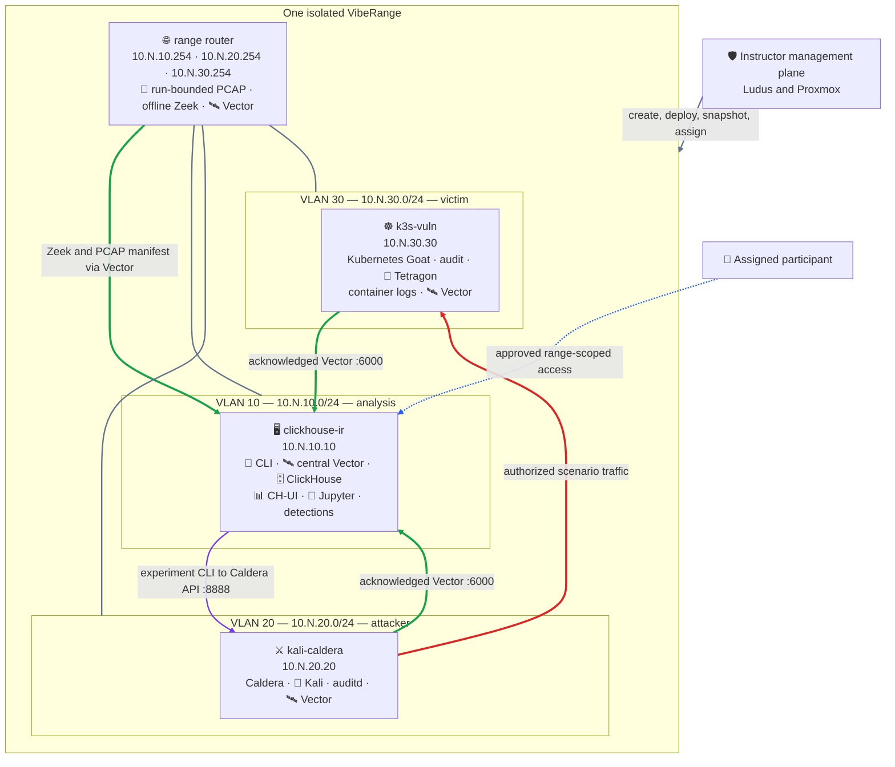
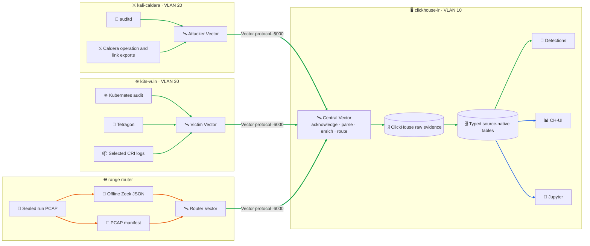
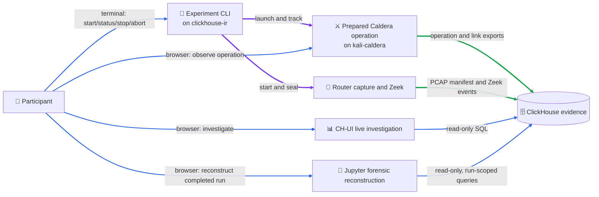
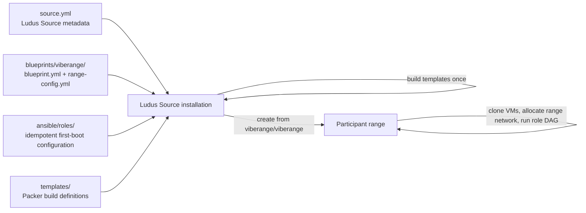

# VibeRange: reproducible purple-team forensic experiments

In this workshop, we build practical foundations in cyber forensics,
virtualization, automation, and reliable cyber experiment design. Participants use
those foundations to run an observable purple-team experiment on
[Ludus](https://ludus.cloud) and explore where AI-assisted workflows can help
without replacing source evidence or deterministic checks.

The lab follows one repeatable attack chain across an isolated virtual network.
Participants see both sides of the exercise: Caldera's intended offensive
actions and the independently collected network, host, container-runtime, and
Kubernetes evidence used to reconstruct them.

### AI disclaimer

**I used AI to generate a significant portion of this lab, and that is part of the
point. AI is a tool that can help individuals produce digital work at a higher
level.** If something looks wrong, unclear, or just dumb, message me or send a pull request so it can be fixed. A PR also preserves your contribution in the Git history.

## Workshop outcomes

Participants should arrive with basic Linux command-line familiarity and a
working knowledge of common cyber forensic concepts. They leave with a repeatable
method for designing cyber experiments and a versioned Ludus blueprint they can
adapt to their own infrastructure.

### Objectives

- understand the virtualization and automation primitives that make cyber range
  execution repeatable;
- evaluate forensic collection and post-experiment analysis choices, including
  collection agents and the trade-offs between various SIEM stacks;
- unpack the lab's forensic pipeline built on Vector and ClickHouse while identifying forensic collection pain points;
- learn network data collection fundamentals;
- investigate Kubernetes control-plane, container, process, and network
  evidence;
- understand how victim-system design affects the real-world efficacy of offensive actions and defensible validation;
- examine a purpose-built proof-of-concept experiment framework and the design
  trade-offs behind it;
- design and evaluate detections from observed evidence while keeping detection
  claims tied to source records.

Detection engineering is intentionally the most open-ended objective. The goal
is not to ship a universal ruleset; it is to build enough evidence integrity to
trust why a detection did or did not fire.

### Content

The numbered directories are the participant curriculum. Authoritative
deployment implementation lives under `blueprints/`, `ansible/`, `templates/`,
and `scripts/`.

| Step | Directory | Participant activity |
|---:|---|---|
| 1 | `01-ludus-range/` | Connect to and inspect the instructor-created assigned range. |
| 2 | `02-clickhouse/` | Enter the `clickhouse-ir` analyst environment and log in to CH-UI. |
| 3 | `03-vector/` | Understand live dashboards, source freshness, buffering, and evidence flow. |
| 4 | `04-router-evidence/` | Understand bounded PCAP, sealing, Zeek processing, Vector delivery, and replay. |
| 5 | `05-k8s-telemetry/` | Understand Kubernetes audit, Tetragon, CRI logs, and victim transport. |
| 6 | `06-k8s-goat/` | Review the prepared vulnerable target and authorized scenario context. |
| 7 | `07-caldera/` | Review the prepared attacker operation and attacker ground truth. |
| 8 | `08-experiment-framework/` | Start/stop the prepared run and investigate evidence by run ID. |
| 9 | `09-detection-and-reporting/` | Review validated detections and generate the forensic notebook/HTML output. |

The workshop moves from infrastructure and isolation boundaries to collection,
attack execution, reconstruction, and detection. Ludus creates the same router
and three workload VMs for every range. Caldera provides attacker intent and
results; Vector, router capture and Zeek, Kubernetes audit, Tetragon, and
container logs provide independent evidence. ClickHouse keeps the source-native
records used by CH-UI and Jupyter.

### Range VMs

| System | Network role | Purpose |
|---|---|---|
| `clickhouse-ir` | VLAN 10 | Analyst CLI, central Vector, ClickHouse, CH-UI, detections, Jupyter, reports |
| `kali-caldera` | VLAN 20 | Prepared Caldera operation, optional participant Kali activity, attacker auditd/Vector |
| `k3s-vuln` | VLAN 30 | Kubernetes Goat, Kubernetes audit, Tetragon, container evidence, victim Vector |
| range router | all range VLANs | Routing plus run-bounded PCAP, offline Zeek processing, router Vector |

### Diagram key

The same symbols and line colors are used in the diagrams below.

| Symbol | Component | Runs on | Role |
|---:|---|---|---|
| 🧑 | Participant | Participant workstation | Uses the assigned range through approved access paths |
| 🧭 | Experiment CLI | `clickhouse-ir` | Controls run state, Caldera execution, and router capture |
| 🛰️ | Vector | All four range systems | Buffers and transports source-native evidence |
| 🗄️ | ClickHouse | `clickhouse-ir` | Stores authoritative raw and typed evidence |
| 📊 | CH-UI | `clickhouse-ir` | Live investigation and dashboards |
| 📓 | JupyterLab | `clickhouse-ir` | Post-experiment reconstruction and reporting |
| ⚔️ | Caldera and Sandcat | `kali-caldera` | Executes the prepared attack and exports attacker ground truth |
| 🐧 | Kali and auditd | `kali-caldera` | Attacker workspace and host-execution evidence |
| ☸️ | k3s and Kubernetes Goat | `k3s-vuln` | Intentionally vulnerable target environment |
| 🔬 | Tetragon | `k3s-vuln` | Process, container, and kernel/runtime evidence |
| 🦓 | PCAP and Zeek | range router | Captures bounded traffic and produces network evidence |

| Line | Meaning |
|---:|---|
| 🔵 Blue | Participant access or read-only analysis |
| 🟣 Purple | Experiment orchestration and control |
| 🔴 Red | Authorized attack traffic |
| 🟢 Green | Evidence collection and Vector transport |
| 🟠 Orange | PCAP/artifact processing |
| ⚫ Gray | Management or network attachment |

### Range topology

For range number `<N>`, Ludus allocates three isolated `/24` networks. The final
number in each VM address is fixed by the blueprint; `<N>` changes per assigned
range.



Inter-VLAN traffic is denied by default. The blueprint allows the prepared
attacker-to-victim path and the edge-to-central Vector paths needed by the
experiment. Participants do not receive Proxmox, Source, or cross-range access.

### Evidence model



Edge Vector agents preserve native records and send acknowledged traffic to the
central Vector service on `clickhouse-ir`. ClickHouse retains authoritative raw
records and typed source-native tables for auditd, Kubernetes audit, Tetragon,
containers, Caldera, Zeek, PCAP manifests, and detections. The sealed PCAP stays
on the router; Vector transports its manifest and the JSON produced by offline
Zeek processing.

See [`03-vector/README.md`](03-vector/README.md) for source contracts, buffering,
parse-error handling, run membership, dashboards, and the authoritative role
configuration.


## Participant Perspective
VibeRange is an authorized, isolated Ludus workshop in which participants execute one full attack chain against Kubernetes Goat, watch independent evidence arrive, and reconstruct the run from source-citing ClickHouse records.

The difficult infrastructure and integration pieces are prepared so participants
can inspect a working example instead of spending the workshop assembling one.
This is not presented as the only—or most robust—way to build a cyber
experiment. It is a concrete starting point whose design choices and limitations
are visible.

This section explains what is already configured when a participant enters the
range and what they will do during the workshop.

### Instructor setup vs Participant execution

Before the workshop, the instructor:

- installs the pinned Git-backed Ludus Source;
- builds the Source-owned Proxmox VM templates;
- creates, deploys, and validates each range and its evidence flows;
- snapshots the clean participant baseline; and
- assigns one range to each participant or team.

Each participant receives only a fresh WireGuard profile for one assigned range
plus approved guest/application credentials. Participants may have sudo inside
their assigned lab VMs, but they do not receive Ludus API keys, PAM/Proxmox
passwords, Source access, host SSH, management-plane, or cross-range access.


If participants are able to break out of virtual machine containment, Congratulations! You either have a reportable zero-day, OR I've screwed up. If the former, ideally just let us know, so we can tell in our monitoring, and do what you want with the new information. If the latter, please message @mastermjr/@darklord on discord.

Regardless, you'll definitely deserve a CTF reward, and thanks for helping make the lab that much more secure :)

### Participant interaction model

`clickhouse-ir` (`10.<range-number>.10.10`) is the main analyst VM. It runs the
experiment CLI, central Vector, ClickHouse, CH-UI, JupyterLab, and the detection
runner. `kali-caldera` (`10.<range-number>.20.20`) runs Kali, the Caldera server
and agent, and attacker Vector. `k3s-vuln` (`10.<range-number>.30.30`) runs k3s,
Kubernetes Goat, Tetragon, Kubernetes audit logging, and victim Vector. The
range router connects all three VLANs and owns packet capture, offline Zeek
processing, and router Vector.

These interfaces have separate responsibilities:



The experiment CLI on `clickhouse-ir` controls the run lifecycle, calls the
Caldera API on `kali-caldera`, and starts and seals router capture. Caldera
executes the prepared attack against Kubernetes Goat. CH-UI on `clickhouse-ir`
is the live evidence workspace. Participants can also open Caldera through the
instructor-approved access path to observe the prepared operation, links, and
results. JupyterLab, also on `clickhouse-ir`, is a post-experiment forensic path:
it reads the completed run's ClickHouse evidence
and generates the reproducible notebook and HTML report. Jupyter does not start,
stop, or modify the attack.

### Analyst interfaces

Replace `<range-number>` with the number in the participant assignment. Connect the assigned WireGuard profile before opening any range-local interface.

| Interface | Runs on | Range-relative location | Purpose |
|---|---|---|---|
| **Experiment CLI** | `clickhouse-ir` | Participant terminal on the analyst VM | Start, inspect, stop, or abort the bounded run |
| **CH-UI** | `clickhouse-ir` | `http://10.<range-number>.10.10:3488` | Live evidence, verified searches, dashboards, detections, and run investigation |
| **JupyterLab** | `clickhouse-ir` | `http://10.<range-number>.10.10:8889` | Execute the forensic notebook and generate the final notebook/HTML report |
| **Caldera** | `kali-caldera` | `http://10.<range-number>.20.20:8888` through the assigned WireGuard profile | Observe the prepared operation, links, status, and results |
| **Kubernetes Goat** | `k3s-vuln` | `10.<range-number>.30.30:1230–1236` from an authorized range path | Intentionally vulnerable experiment target |

#### Login notes

- **JupyterLab:** no username, password, or token is required. Access is controlled by the assigned WireGuard profile.
- **Caldera:** log in with username `admin` and password `admin`.
- **CH-UI:** log in with username `default` and leave the password field blank.

CH-UI, JupyterLab, and Caldera are participant-facing interfaces permitted only from the assigned WireGuard client. Direct participant access to Kubernetes Goat remains denied; the bounded experiment reaches it from the attacker VLAN. Proxmox and Ludus administration remain instructor-only.

# Ludus blueprint design

This section is for instructors and contributors who want to understand the
Ludus packaging and deployment model. Participants do not need it to complete
the workshop.

## Overview

VibeRange is distributed as one Ludus Source. The Source keeps the topology,
role graph, and Packer inputs together so an instructor installs one immutable
release instead of manually publishing individual roles.



The blueprint is split deliberately:

- [`blueprints/viberange/blueprint.yml`](blueprints/viberange/blueprint.yml)
  carries the blueprint ID, release version, compatibility metadata, and points
  Ludus to the range configuration.
- [`blueprints/viberange/range-config.yml`](blueprints/viberange/range-config.yml)
  defines the router and three workload VMs, templates, CPU/RAM, VLANs, fixed
  host octets, firewall policy, Ansible groups, role ordering, and testing
  snapshot behavior. It contains no participant credentials or experiment IDs.
- [`ansible/roles/`](ansible/roles/) owns first-boot and range-specific state:
  addresses, range identity, service configuration, credentials, dashboards,
  notebooks, and health checks. Role dependencies in `range-config.yml` form
  the deployment DAG.
- [`templates/`](templates/) contains the Source-owned router, clickhouse-ir,
  Kali/Caldera, and k3s-vuln Packer definitions. They bake pinned applications and large static
  assets; Ansible still creates range identity and mutable runtime state.
- [`docs/ludus-host-prerequisites.md`](docs/ludus-host-prerequisites.md) is the
  instructor checklist for Proxmox, Ludus, storage, template builds, Source
  access, and operational boundaries.

An instructor installs a pinned Source release, builds the four Source-owned
templates once, creates a range from `viberange/viberange`, deploys the role
graph, validates it, snapshots the clean baseline, and assigns the range. A
contributor changes the authoritative role or blueprint first, synchronizes any
template-owned copies, runs the repository preflight, and validates on a clean
range before publishing a new Source release.

## Architecture

See [`docs/architecture.md`](docs/architecture.md) for the workshop topology, evidence flow, network policy, and teaching strategy.

## Local contributor validation

Use the pinned development shell:

```bash
nix develop
./scripts/workshop-preflight.sh
```

Keep API keys, passwords, private keys, session cookies, raw participant evidence, and environment-specific management addresses out of Git, issue trackers, slides, and participant documentation.

## Self-hosting

A single VibeRange is intentionally modest for a Proxmox/Ludus lab. The host
must provide:

- a working Ludus installation backed by Proxmox;
- approximately **28 GB RAM and 10 vCPU** available to the range itself;
- additional headroom for Proxmox, Ludus, filesystem cache, Packer, and snapshot
  operations. Therefore a practical single-range host has roughly **32–40 GB RAM** and at
  least **12 logical CPUs**;
- snapshot-capable, thin-provisioned VM storage; **200–300 GB of physical free
  space** is a reasonable starting point for one range, templates, evidence,
  and snapshot growth, although the virtual disks are deliberately larger and
  thin provisioned;
- ISO/filesystem storage for the Debian and Kali installers;
- outbound access while building templates and performing the first deployment;
- the four Source-owned router, clickhouse-ir, Kali/Caldera, and k3s-vuln templates;
- unauthenticated HTTPS access to the public Git Source.

Storage and capacity depend on retained PCAP, ClickHouse, container-image, and
snapshot data. See
[`docs/ludus-host-prerequisites.md`](docs/ludus-host-prerequisites.md) for the
full sizing and network checklist.

### Install and deploy

Register the GitHub repository as the Ludus Source and pin production to an
immutable release tag:

```bash
ludus source add \
  https://github.com/Mastermjr/viberange-workshop.git \
  --id viberange \
  --ref <immutable-release-tag> \
  --all \
  --global
```

VibeRange does not use directory, tar, or other upload-backed Sources. Reviewed
changes are committed and pushed to GitHub first; Ludus then clones or syncs the
Git Source. The ADMIN workflow in [`docs/administration.md`](docs/administration.md)
owns repository authentication, Source promotion, sync, and installation.

Confirm that the required Debian and Kali installer ISOs are available, then
build the four Source-owned templates once. Build Packer
templates serially to avoid unnecessary storage and CPU contention:

```bash
ludus templates list
ludus templates build -n viberange-router-debian12-v1-template
ludus templates build -n viberange-clickhouse-ir-debian12-v1-template
ludus templates build -n viberange-kali-caldera-v1-template
ludus templates build -n viberange-k3s-vuln-debian12-v1-template
```

For a production participant range, render the canonical configuration with the
protected site management CIDRs, then create and deploy it:

```bash
scripts/render-secure-range-config.sh \
  --range-number <assigned-range-number> \
  --blocked-networks /protected/viberange/blocked-networks.json \
  --wireguard-client-octet <assigned-user-number> \
  --output /protected/viberange/my-viberange-range-config.yml

ludus -r my-viberange range create --name "VibeRange"
ludus -r my-viberange range config set \
  -f /protected/viberange/my-viberange-range-config.yml
ludus -r my-viberange range deploy
```

The generic Source has no private site CIDRs and is not sufficient by itself for
a participant range. See [`docs/administration.md`](docs/administration.md).

Ludus then clones the templates, assigns range-specific networking and identity,
and executes the Ansible dependency graph. The roles initialize k3s and
configure ClickHouse, Vector, Caldera, Tetragon, Kubernetes Goat, dashboards,
Jupyter, detections, and evidence tooling.

Packer template construction is a one-time host operation, not VM boot time.
Build and deployment duration depends on host CPU, storage, network throughput,
and upstream registries. Deploy and validate a complete range before participant
use; subsequent turnover can use clean per-range snapshots for the fast reset
path.

## Future work

- support additional versioned Caldera operations;
- deepen native Ludus integration for experiment lifecycle controls;
- continue expanding detection and reconstruction exercises.

## License

VibeRange is released under the [BSD 3-Clause License](LICENSE). Retained upstream-derived Ansible roles remain under their stated licenses; see [`ansible/LICENSE`](ansible/LICENSE) and [`ansible/README.md`](ansible/README.md).
