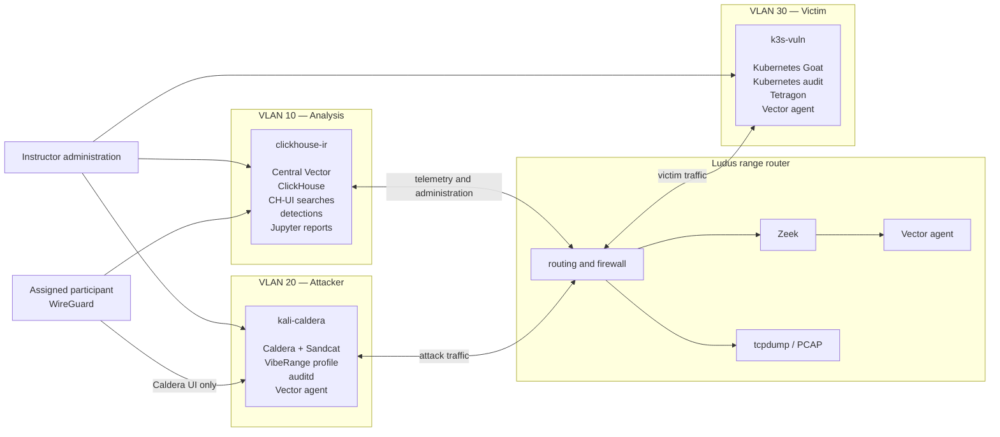
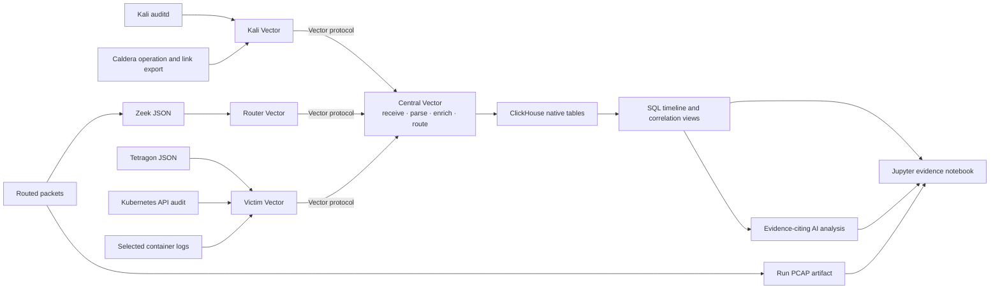
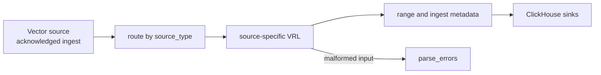
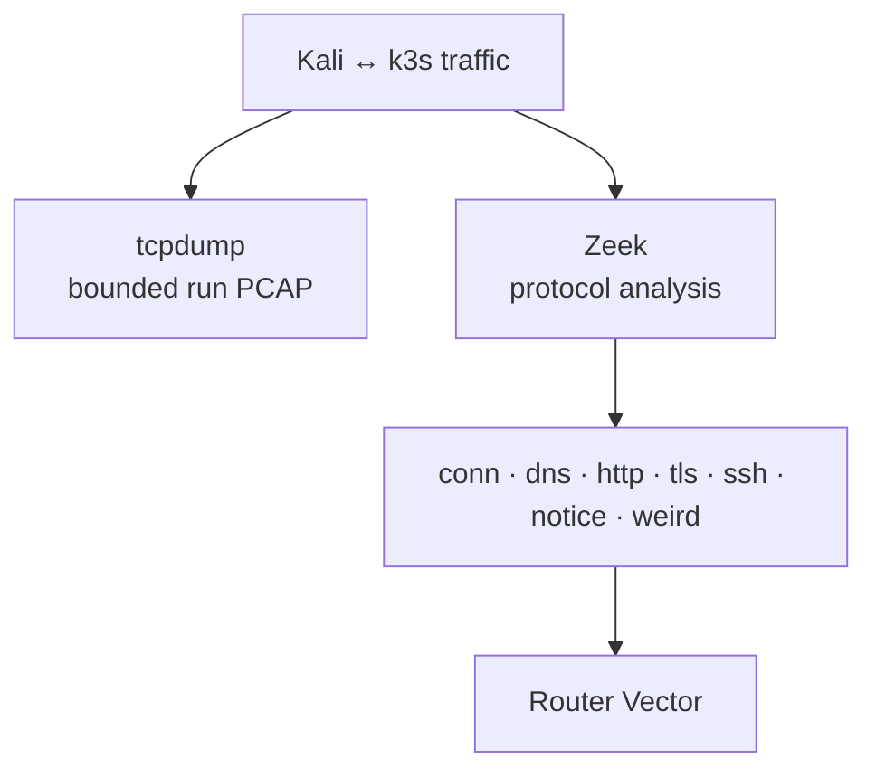
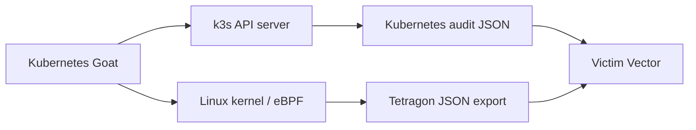
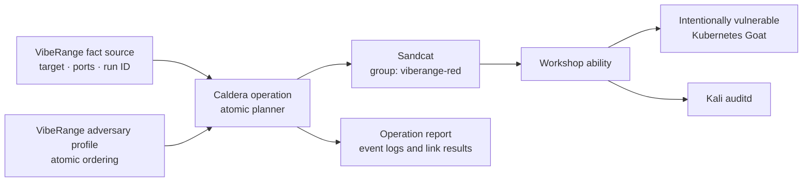
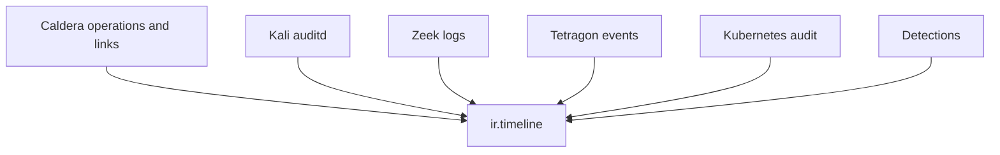
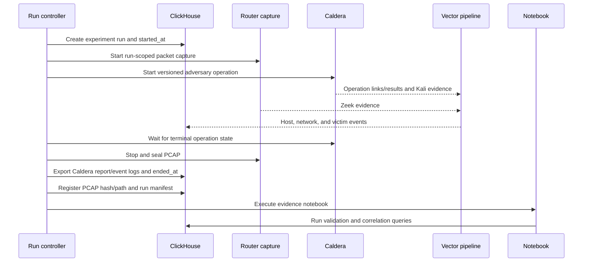
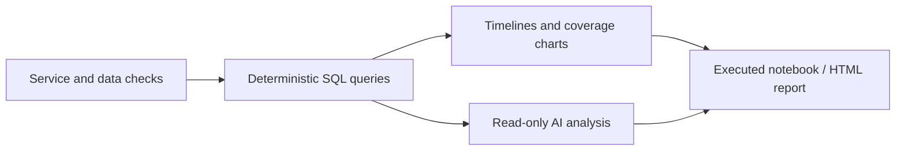

# VibeRange Workshop Architecture

## Purpose

VibeRange teaches participants to design, run, and reconstruct a bounded purple-team forensic experiment one evidence source at a time. The workshop starts with infrastructure and network boundaries, executes one controlled Lockheed Martin Cyber Kill Chain scenario, then correlates network, host, and Kubernetes evidence in ClickHouse and a reproducible Jupyter report.

This document defines the published workshop architecture and teaching strategy. The canonical blueprint, roles, and templates implement this design; the numbered modules provide the participant workflow.

The workshop is intentionally not a turnkey SIEM or an attack-platform course. It is a transparent evidence and detection-engineering lab whose collection, storage, correlation, and reporting logic students can inspect.

### Authorized-use boundary

VibeRange is an authorized purple-team exercise conducted inside an isolated Ludus range owned or administered by the workshop operator. Kubernetes Goat is intentionally vulnerable and exists specifically for security training. Caldera abilities in this workshop target only the designated Kubernetes Goat instance and lab addresses in the run fact source. They are expected, permitted workshop activity within that boundary; they are not instructions or authorization to target systems outside the range.

## Workshop promise

By the end of the workshop, a participant should be able to:

- explain what each evidence source can and cannot prove;
- execute a safe, deterministic attack story with explicit run boundaries;
- preserve PCAP and source-native telemetry without hiding it behind a SIEM;
- correlate attacker, network, runtime, and Kubernetes control-plane evidence with inspectable SQL;
- validate a small set of detections and identify visibility gaps;
- produce an evidence-citing report that another participant can rerun.

The deliverable is one reconstructed experiment, not a collection of disconnected tools or attack demos.

## Workshop narrative

The workshop builds the final system in this order:

1. **Frame the experiment** — define the run, the seven Cyber Kill Chain phases, safety boundaries, and the evidence expected at each phase.
2. **Build the Ludus laboratory** — deploy reproducible VMs, VLANs, routing, firewall policy, and range lifecycle.
3. **Establish network evidence** — capture attacker-to-victim traffic as PCAP and derive Zeek metadata.
4. **Establish host and cluster evidence** — collect Kali audit, Kubernetes API audit, and Tetragon runtime events.
5. **Execute one bounded chain** — run a versioned, noninteractive scenario from reconnaissance through actions on objectives.
6. **Collect and model evidence** — use Vector, source-native ClickHouse tables, explicit run metadata, and integrity checks.
7. **Reconstruct and detect** — use deterministic SQL, a small detection set, and a reproducible Jupyter report.

Each stage answers one question and produces an artifact that can be checked before moving on. AI-assisted narration is an optional final step, never a prerequisite for a successful workshop.

## Release scope

### Included in this release

- one tested Ludus topology for at most five concurrent ranges;
- one versioned, Caldera-native Kubernetes Goat operation following the Lockheed Martin Cyber Kill Chain, with safe reset and cleanup;
- router PCAP plus replayable Zeek output;
- Kali auditd, Kubernetes audit, and Tetragon evidence;
- reliable Vector transport into source-native ClickHouse tables;
- explicit run manifests, timestamps, hashes, and source health checks;
- deterministic timeline/correlation views and three to five scenario-aligned detections;
- one notebook that reconstructs the chain and cites source records;
- one preconfigured CH-UI workspace with participant access, curated saved searches, and a live evidence dashboard over the same ClickHouse views.

### Explicitly deferred

- Caldera server administration beyond what is needed to inspect and run the supplied operation;
- additional adversary profiles or a menu of unrelated Kubernetes Goat labs;
- OCSF normalization as the primary storage model;
- Cilium/Hubble, a multi-node cluster, live Zeek, and a separate SIEM UI;
- autonomous AI control of infrastructure or attacks;
- production hardening, multi-tenancy, and internet-exposed operation.

Deferral is deliberate: the first release optimizes for a complete, teachable evidence story rather than maximum tooling breadth.

## Design decisions

1. **Use agents on systems we control.** Vector agents provide file checkpoints, acknowledgements, buffering, retries, and backpressure without custom polling or watermark code.
2. **Preserve source-native evidence.** Zeek, Tetragon, Kubernetes audit, attacker run records, and auditd retain their native meaning in typed source tables. OCSF is not required by the core architecture and may be added later as an export or teaching exercise.
3. **Separate evidence from interpretation.** Raw artifacts and typed rows are authoritative. SQL performs explicit, repeatable correlation. Notebooks validate and visualize results. AI explains evidence but does not invent the event graph.
4. **Capture both network metadata and packets.** Zeek supplies searchable protocol metadata; PCAP remains the packet-level artifact.
5. **Treat experiment boundaries as data.** A run has an identity, scenario version, start time, end time, execution record, and artifact manifest. Agents do not need to restart when a run changes.
6. **Prefer bounded, reproducible stages over hidden automation.** A sealed PCAP can be processed again, a SQL view can be inspected, and a notebook can be rerun.
7. **Use Caldera natively for controlled red-side orchestration.** Workshop-owned ability, adversary, fact-source, parser, requirement, and objective content defines one deterministic operation. Caldera operation and link records are authoritative attacker ground truth alongside Kali auditd.
8. **Keep the primary stack small.** Ludus, Caldera, Vector, ClickHouse, CH-UI, Zeek, Tetragon, and Jupyter are sufficient. CH-UI is only a saved-search and dashboard layer over the authoritative ClickHouse data; Elasticsearch, Wazuh, Splunk, Arkime, Kafka, and ClickStack are not required.

## Range topology

Ludus runs a router plus three workload VMs on isolated VLANs.



| Component | VLAN | Starting size | Purpose |
|---|---:|---:|---|
| Ludus router | range-managed | 2–4 GB RAM, 2 vCPU | Inter-VLAN choke point, Zeek, packet capture |
| `clickhouse-ir` | 10 | 10–12 GB RAM, 3–4 vCPU | Central Vector, ClickHouse, CH-UI, detections, notebooks, artifacts |
| `kali-caldera` | 20 | 6 GB RAM, 2 vCPU | Caldera operation execution and attacker ground-truth evidence |
| `k3s-vuln` | 30 | 8 GB RAM, 3–4 vCPU | Vulnerable cluster, API audit, Tetragon runtime evidence |

The final sizes must be validated with Tetragon and Zeek enabled. The workshop currently targets no more than five concurrent ranges on the available Ludus host.

## Network policy

Inter-VLAN traffic is denied by default and only the experiment paths are allowed:

```text
VLAN 20 → VLAN 30    attacker exercises Kubernetes Goat
VLAN 30 → VLAN 20    narrowly scoped Caldera callback from a controlled workshop foothold
VLAN 20 → VLAN 10    Kali Vector sends telemetry to central Vector
VLAN 30 → VLAN 10    victim Vector sends telemetry to central Vector
router  → VLAN 10    router Vector sends Zeek telemetry
operator → workloads administration and workshop access
```

ClickHouse does not need to accept writes directly from every source. Edge agents send to central Vector, and only central Vector holds ClickHouse write credentials.

## Telemetry architecture



### Edge Vector agents

Edge agents have a deliberately narrow responsibility:

```text
read local source
→ preserve the native event
→ attach source_type and source_host
→ checkpoint and buffer
→ send with acknowledgements
```

Suggested source types:

| Host | Source type | Native evidence |
|---|---|---|
| Kali | `linux_auditd` | Attacker process and host activity |
| Kali | `caldera_operation` | Operation, adversary, ability, link, command, timestamps, result, facts, status |
| Router | `zeek` | Zeek JSON logs with `_path` identifying the log type |
| k3s | `tetragon` | Process lifecycle and tracing-policy events |
| k3s | `kubernetes_audit` | Kubernetes API server audit JSON |
| k3s | `container_log` | Selected workload/application output |

Agents use the native Vector protocol with acknowledgements and disk buffers over explicitly allowed range-internal paths. Vector internal metrics expose buffer usage, delivery errors, dropped events, and unrouted events. Deployment validation checks every expected source before participant use.

### Central Vector

All substantial parsing is centralized:



Central parsing prevents configuration drift across agents. Valid but unfamiliar events are retained with their raw data rather than discarded. Only malformed input enters a parse-error table.

## Network evidence: router PCAP and Zeek

Kali is on VLAN 20 and k3s is on VLAN 30, so Kali-to-k3s traffic crosses the Ludus router. Capturing on one victim-facing router interface avoids duplicate packets and does not require a separate sensor VM.

The router provides two products:



- **Zeek logs** answer who communicated, over which protocol, for how long, and with what protocol metadata.
- **PCAP** preserves packet headers and available payload bytes for Wireshark or `tshark`.
- Encrypted traffic still exposes flow and TLS metadata but not decrypted application payloads.

The staged and most reproducible mode is:

```text
start run capture
→ execute scenario
→ stop and seal PCAP
→ run Zeek against the sealed PCAP
→ send generated JSON through Vector
→ retain PCAP in the run artifact manifest
```

Live Zeek can be added later, but processing a sealed PCAP guarantees that parser changes can be replayed without rerunning the attack.

Ludus Pro router roles are convenient but not required. Community Ludus can apply an idempotent post-deployment Ansible play against the router. A range rebuild simply reruns that instrumentation stage.

## Victim evidence: Kubernetes audit and Tetragon

The victim uses two authoritative but different views:

| Source | Question answered |
|---|---|
| Kubernetes API audit | Who called the API, with which verb, against which resource, and was it allowed? |
| Tetragon | Which node, pod, container, process, or kernel hook performed an action? |

Tetragon runs on k3s without requiring a Cilium CNI replacement. Cilium and Hubble are deferred; replacing the cluster network is unnecessary for the first workshop version.



Tetragon emits process lifecycle events by default and tracing-policy events for selected kernel observations:

```text
process_exec
process_exit
process_kprobe
process_tracepoint
process_uprobe
process_loader
```

The workshop retains every valid emitted event. TracingPolicies determine which additional kernel observations exist; they are not filters in Vector. Initial policies should cover bounded, scenario-relevant observations such as socket connect/bind/accept, sensitive file access, capability or credential changes, and namespace/container escape behavior. Capturing every syscall or file operation would add noise and overhead without improving the experiment.

Central Vector promotes only stable, frequently queried Tetragon fields:

```text
event_time · event_type · node_name
namespace · pod_name · container_name · container_id
exec_id · parent_exec_id · pid · parent_pid · uid
binary · arguments · cwd
policy_name · function_name · action
```

The complete Tetragon JSON remains in `raw_data`. Policy-specific arguments remain authoritative in the raw event and can later be exposed through SQL views.

## Attacker ground truth: Caldera operation

Caldera is the controlled red-side orchestration and attacker ground-truth system for this purple-team experiment. It is one section of the larger workshop: students inspect and run a supplied operation, then compare Caldera's intended actions and results with independently collected network, host, runtime, control-plane, and detection evidence.

Kali supplies two complementary records:

1. **Host execution evidence** from auditd, transported by Vector.
2. **Caldera ground truth** from the operation, adversary, abilities, links, commands, facts, timestamps, statuses, and results.



### Caldera-native content model

The workshop owns a small Caldera plugin rather than constructing an adversary from names at run time:

```text
plugins/viberange/
├── hook.py
├── data/
│   ├── abilities/       stable UUIDs, ATT&CK metadata, executors, parsers, requirements
│   ├── adversaries/     one ordered Kubernetes Goat profile
│   ├── sources/         range facts such as target, ports, callback, and run ID
│   └── objectives/      bounded operation success criteria
└── app/
    ├── parsers/         turn selected ability output into learned facts
    └── requirements/    gate later links on required facts
```

Caldera concepts map to the experiment as follows:

| Caldera object | VibeRange role |
|---|---|
| Agent/group | Sandcat on Kali in the dedicated `viberange-red` group |
| Ability | One stable, independently testable action executed from Kali against the authorized Goat target |
| Fact source | Environment-specific target address, scenario ports, callback address, and run ID |
| Parser | Extracts a bounded learned fact from an ability result for a later link |
| Requirement | Prevents a link from being generated until its facts and execution context are valid |
| Adversary profile | Versioned ordered collection of the workshop abilities |
| Planner | `atomic`, preserving the profile's explicit ordering |
| Operation | One execution of the profile for one experiment run |
| Link | One delegated ability execution, including command, status, timestamps, and result |
| Objective | Explicit success criteria for the bounded lab operation |

The operation API selects the checked-in adversary UUID, fact-source UUID, `atomic` planner, and `viberange-red` group. Abilities use facts instead of hard-coded range addresses. Name-based ability lookup and inherited generic demo profiles are not used for the published operation.

The operation follows the **Lockheed Martin Cyber Kill Chain** while each ability retains its appropriate MITRE ATT&CK tactic and technique metadata:

| Kill-chain phase | Controlled workshop action | Minimum expected evidence |
|---|---|---|
| Reconnaissance | Discover the exposed Goat services and selected entry path from Kali | Caldera link, Kali auditd, Zeek connections |
| Weaponization | Resolve run facts and stage a benign, version-pinned input for the known vulnerable path | Caldera facts/link, payload hash, Kali file/process evidence |
| Delivery | Send the controlled input to the selected vulnerable service | Caldera link, Zeek connection/HTTP metadata, Kali process evidence |
| Exploitation | Trigger the validated vulnerable path and prove execution in the target workload | Caldera result, Tetragon process event, Zeek response |
| Installation | Start a disposable, clearly labeled workshop foothold when the selected chain requires it | Caldera agent/link record, Tetragon lineage, pod/container identity |
| Command and Control | Permit only the narrowly scoped callback defined by the range policy | Caldera agent record, Zeek connection, Tetragon socket event |
| Actions on Objectives | Perform bounded discovery and one non-destructive service-account/RBAC or secret-access proof | Caldera links, Kubernetes audit, Tetragon evidence, detection results |

Kubernetes Goat is a set of mostly independent labs, not a naturally causal chain. The profile includes only transitions validated on the pinned Goat version. A prerequisite or instructor-controlled handoff is recorded explicitly; the workshop never claims that one phase enabled the next when it did not.

Each ability has a stable UUID, prerequisites, expected executor and agent context, a terminal success/failure condition, expected evidence, timeout, and cleanup behavior. A failed required link stops the operation visibly. Resource exhaustion, uncontrolled persistence, destructive actions, and activity outside the isolated Ludus range are excluded.

Sandcat runs on Kali, so its normal abilities execute on Kali and interact with Goat through the vulnerable service. Actions inside a compromised workload occur through that validated path. A second temporary Sandcat agent is introduced only when installation and callback behavior are explicitly part of the selected chain, and it uses a separate controlled group and cleanup step.

After the operation reaches a terminal state, the run controller exports both the Caldera operation report and operation event logs, including agent paw, adversary ID, ability ID, link ID, command, delegated/run timestamps, status, output, and seeded or learned facts. Those records are preserved as attacker ground truth and correlated with independent evidence; Caldera results do not substitute for Zeek, auditd, Tetragon, or Kubernetes audit observations.

## ClickHouse evidence model

ClickHouse stores source-native, typed evidence rather than forcing unrelated sources into one schema.

```text
ir.experiment_runs
ir.caldera_operations
ir.caldera_links
ir.linux_auditd
ir.tetragon_events
ir.kubernetes_audit
ir.container_logs
ir.zeek_conn
ir.zeek_dns
ir.zeek_http
ir.zeek_tls
ir.zeek_notice
ir.detections
ir.pcap_artifacts
ir.parse_errors
```

Every table includes a small common envelope where applicable:

```text
event_id
source_type
source_host
event_time
ingested_time
range_id
raw_data
```

Source tables additionally expose their native, frequently queried fields. The original event remains available for forensic verification.

### Why ClickHouse instead of an Elasticsearch-style stack

For this workshop, ClickHouse keeps the data model and analysis path explicit:

- SQL is the native query language.
- Typed columns and compression fit high-volume event data.
- Joins, window functions, arrays, JSON extraction, and aggregations are available without a proprietary search language.
- A saved SQL view is inspectable workshop content.
- The notebook, AI tools, detection rules, and optional dashboards all query the same database.
- The stack does not require Elasticsearch, Fleet, Kibana, Wazuh, or a separate search-head model.

Vector performs collection, transport, parsing, and routing. ClickHouse performs historical queries, correlation, and analytical detections. Those responsibilities remain separate.

## Deterministic views and reconstruction

A deterministic view is a normal saved SQL query with explicit correlation rules. Given the same input rows, it produces the same result. It may still encode an imperfect rule, but the rule is visible, testable, and repeatable.

The primary view is `ir.timeline`, which projects different source tables into a common evidence shape:

```text
event_id · event_time · dataset · source_host
namespace · pod_name · process · user
src_ip · src_port · dst_ip · dst_port · protocol
run_id · scenario_version · caldera_operation_id · caldera_link_id
exec_id · parent_exec_id · zeek_uid
summary · raw_data
```



Additional views can make correlation rules explicit:

```text
ir.process_lineage
ir.network_connections
ir.caldera_execution
ir.kubernetes_actions
ir.experiment_coverage
ir.detection_lag
```

For example, a Tetragon socket event and a Zeek connection may be associated by matching the five-tuple and a bounded time difference. The result records the correlation method and time delta rather than hiding uncertainty.

Normal views are preferred initially because they are easy to inspect and change. Materialized views are an optimization only after the queries and schemas stabilize.

## Experiment lifecycle



`ir.experiment_runs` defines the run boundary:

```text
run_id · scenario_id · scenario_version · range_id
started_at · ended_at
caldera_operation_id · adversary_id
status · manifest_path
```

Events keep their authoritative source timestamps. The timeline associates them with a run by explicit IDs where available and by the bounded run window otherwise. This avoids restarting agents merely to change an environment variable.

## Detection layer

Detections are SQL queries over typed source tables and deterministic views. Detection results are written back to `ir.detections` with the rule ID, run ID, severity, and matching event IDs.

The first detections should remain close to the workshop narrative:

- suspicious credential-file access;
- Kubernetes secret or RBAC enumeration;
- privileged container or namespace behavior;
- unexpected child process from a vulnerable workload;
- attacker connection followed by a victim-side process or API action.

A detection is successful only when its underlying evidence can be inspected and cited.

## Jupyter reporting and AI analysis

The notebook is the canonical workshop analysis interface.



The notebook should:

- verify services and expected datasets;
- display the run manifest and phase-by-phase Caldera operation/link record;
- reconstruct process lineage from Tetragon `exec_id` and `parent_exec_id`;
- correlate network events with Zeek UIDs and five-tuples;
- show Kubernetes API actions and authorization results;
- calculate coverage and detection delay;
- list missing or malformed evidence;
- link the PCAP artifact and provide useful Wireshark filters;
- render detection outcomes;
- optionally ask an AI agent to draft a narrative from the query results.

AI-assisted narration is optional and is not deployed as a workshop service. If used, provide only curated read-only query results and require every factual claim to cite an event ID, Caldera operation/link ID, Zeek UID, Kubernetes audit ID, or artifact. SQL checks remain authoritative.

CH-UI is the participant-facing live exploration interface. It connects directly to the existing ClickHouse instance and ships with shared verified searches and an auto-refresh evidence dashboard. It does not ingest telemetry, normalize evidence, or introduce a second database. Jupyter remains the canonical reproducible report, while CH-UI makes the same source tables and deterministic views easy to browse during the exercise.

## Reconstruction outcome

A completed run should support a narrative such as:

```text
1. Caldera started operation O with adversary profile S and ability A.
2. Sandcat executed bounded command C on Kali and returned link result L.
3. Kali auditd recorded process P.
4. Zeek observed connection Z from Kali to the Goat service.
5. Tetragon observed victim pod process V and its parent lineage.
6. Kubernetes audit recorded API request K.
7. Detection rule D matched events V and K.
8. The notebook linked every claim to source evidence and the run PCAP.
```

The purpose is not merely to produce a dashboard. It is to demonstrate which evidence proves each step, which evidence is missing, and how confidently the experiment can be reconstructed.

## Reliability and evidence integrity

- Vector agents and the aggregator use disk buffers and acknowledgements.
- Buffer saturation, dropped events, parse errors, and unrouted events are measured and fail the evidence checks.
- Source timestamps and ingestion timestamps are stored separately.
- Unknown valid events retain their raw payload.
- PCAP artifacts are sealed with size, hash, capture interface, start time, and end time.
- Caldera operation reports, event logs, link results, and cleanup outcomes are stored after the operation reaches a terminal state.
- The notebook records the exact queries used to produce each result.
- Secrets, API keys, private keys, and environment-specific credentials remain outside the repository.

## Teaching strategy

The workshop should be taught as four evidence-driven blocks rather than as a sequence of product installations:

| Block | Participant question | Hands-on outcome | Gate before continuing |
|---|---|---|---|
| 1. Frame and deploy | What exactly is this experiment allowed to do? | Run manifest, healthy range, enforced network policy | All hosts reachable only over documented paths; clocks and run facts verified |
| 2. Observe | What can each sensor prove? | Marked events in Kali auditd, Zeek/PCAP, Tetragon, and Kubernetes audit | Every required source produces a uniquely identifiable smoke event |
| 3. Execute | Can one bounded chain be repeated safely? | One terminal scenario execution and cleanup record | Every phase has a result; failure is explicit; target returns to baseline |
| 4. Reconstruct | Can another analyst prove what happened? | SQL timeline, detections, coverage gaps, and notebook report | Every narrative claim cites evidence or is labeled an inference/gap |

Instructor-provided automation may deploy prerequisites, but participants should inspect the topology, source contracts, representative raw events, correlation rules, and final evidence. Time should be spent on reasoning about evidence—not debugging a large attack framework during the workshop.

### Publication acceptance gates

The first release is ready only when all of these statements are true on a clean range:

1. Deployment and reset instructions succeed twice without undocumented manual repair.
2. The scenario completes once successfully and fails safely when one deliberate prerequisite is removed.
3. Required evidence sources pass marked-event checks before the scenario begins.
4. Every Cyber Kill Chain phase maps to at least one execution record and one independent observation, or the report labels the visibility gap.
5. PCAP, manifests, source records, detections, and notebook output carry the same run ID.
6. The notebook runs noninteractively from a clean analysis environment and produces the same key findings.
7. Cleanup removes the foothold and scenario artifacts, and a second run does not inherit evidence labels from the first.
8. A reviewer can reconstruct the chain from the artifacts without access to instructor memory or hidden commands.

## Component summary

| Layer | Component | Role |
|---|---|---|
| Range | Ludus / Proxmox | Reproducible VMs, VLANs, routing, lifecycle |
| Attacker | Kali + Caldera + Sandcat + VibeRange plugin | Repeatable, bounded adversary operation and attacker ground truth |
| Attacker telemetry | auditd + Vector | Host execution ground truth |
| Network evidence | tcpdump + Zeek | PCAP and protocol metadata |
| Victim | k3s + Kubernetes Goat | Vulnerable Kubernetes target |
| Victim telemetry | Tetragon + Kubernetes audit | Runtime and control-plane evidence |
| Transport | Vector agents + central Vector | Reliable collection, buffering, parsing, routing |
| Storage | ClickHouse | Typed evidence, SQL correlation, detections |
| Live exploration | CH-UI | Shared verified searches and auto-refresh dashboards over existing ClickHouse views |
| Analysis | Jupyter / Papermill | Reproducible checks, charts, reports |

## References

- [Ludus networking and packet capture](https://docs.ludus.cloud/docs/1/networking/)
- [Lockheed Martin Cyber Kill Chain](https://www.lockheedmartin.com/en-us/capabilities/cyber/cyber-kill-chain.html)
- [MITRE Caldera](https://github.com/mitre/caldera)
- [Caldera terminology](https://caldera.readthedocs.io/en/latest/Learning-the-terminology.html)
- [Caldera operation results](https://caldera.readthedocs.io/en/latest/Operation-Results.html)
- [Vector](https://vector.dev/)
- [ClickHouse](https://clickhouse.com/)
- [Zeek](https://zeek.org/)
- [Tetragon](https://tetragon.io/)
- [Kubernetes auditing](https://kubernetes.io/docs/tasks/debug/debug-cluster/audit/)
