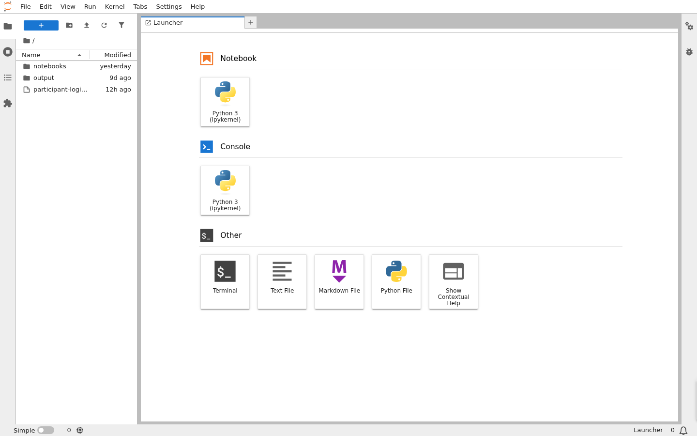
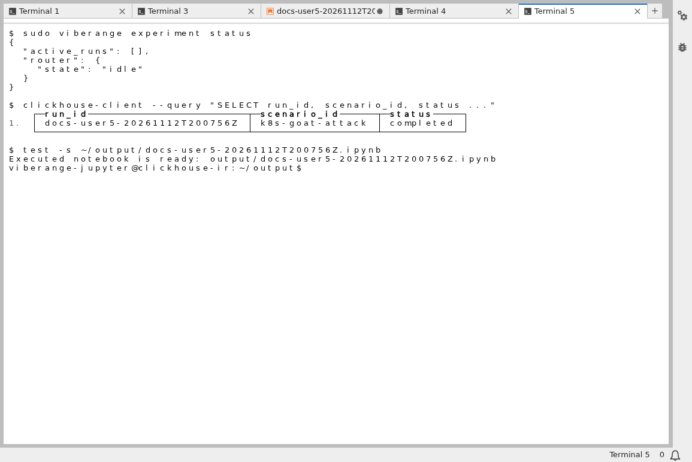
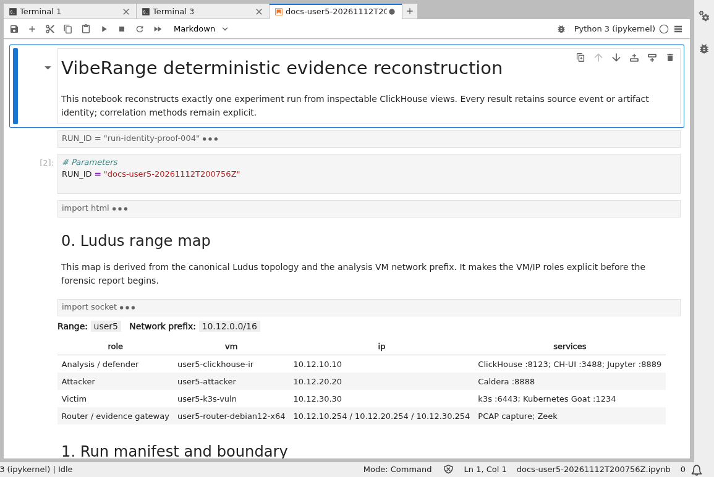
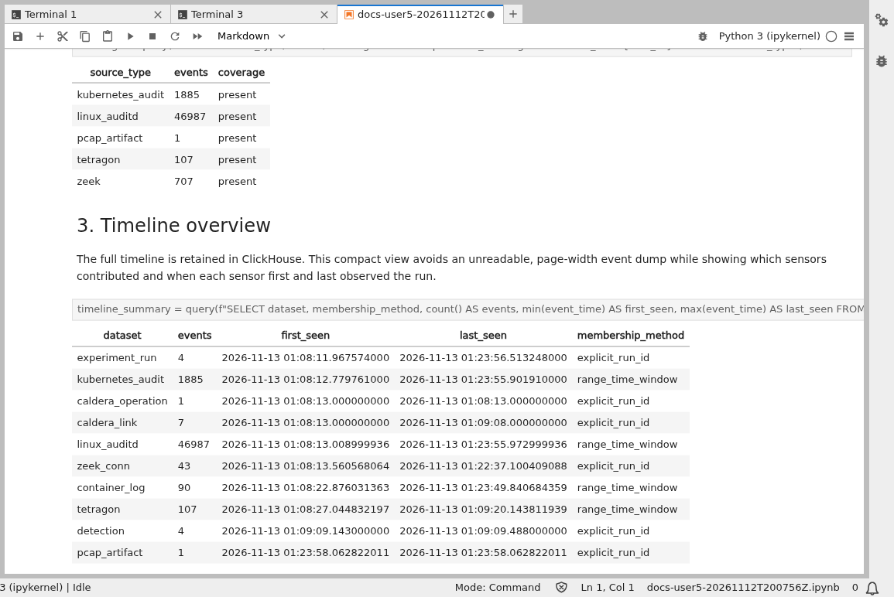
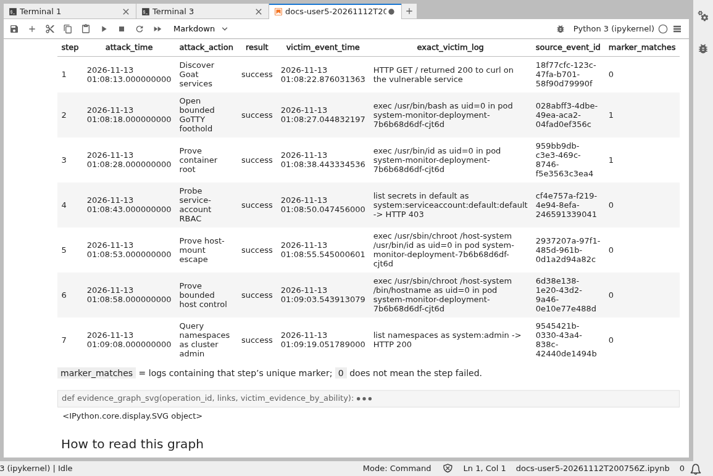

# Run the experiment and reconstruction notebook in JupyterLab

Participants use JupyterLab on the assigned `clickhouse-ir` VM for both the experiment terminal and the forensic notebook. JupyterLab has no application login: the assigned WireGuard profile is the access boundary.

## 1. Open JupyterLab

1. Connect the WireGuard profile delivered by the reservation broker.
2. Replace `<range-number>` with the number in the assignment.
3. Open `http://10.<range-number>.10.10:8889/lab`.

No Jupyter username, password, or token is required. The launcher shows the `notebooks/` and `output/` directories.



## 2. Run the prepared experiment from a terminal

Open **Terminal** from the launcher. Choose a unique run ID and use the prepared scenario:

```bash
run_id="workshop-$(date -u +%Y%m%dT%H%M%SZ)"

sudo viberange experiment status
sudo viberange experiment start k8s-goat-attack \
  --scenario-version 1.0.0 \
  --run-id "$run_id"
sudo viberange experiment status
```

`start` runs the seven-link Caldera operation and starts bounded router capture. When the operation finishes, seal the evidence and complete the run:

```bash
sudo viberange experiment stop --notes 'participant workshop run'
```

If the run cannot complete safely, preserve that outcome instead of calling it successful:

```bash
sudo viberange experiment abort --reason '<reason>'
```

A completed run leaves the router idle and records the run in ClickHouse.



## 3. Execute the reconstruction notebook

The supplied notebooks are:

- `notebooks/00-runtime-check.ipynb` — optional environment and ClickHouse check;
- `notebooks/01-viberange-reconstruction.ipynb` — complete run reconstruction.

### JupyterLab interface

1. Open `notebooks/01-viberange-reconstruction.ipynb`.
2. Replace the `RUN_ID` value in the parameters cell with the completed run ID.
3. Choose **Run → Run All Cells**.
4. Save the executed notebook under `output/` with a run-specific name.

### Reproducible terminal execution

The same notebook can be executed without editing the source copy:

```bash
/opt/viberange/jupyter-venv/bin/papermill \
  notebooks/01-viberange-reconstruction.ipynb \
  "output/${run_id}.ipynb" \
  -p RUN_ID "$run_id"
```

Open the resulting notebook from `output/`. It should show the assigned range map, terminal run manifest, required source coverage, timeline, Caldera links, victim-side evidence, detections, sealed PCAP metadata, and Zeek results.







## 4. Export the report before turnover

Generate an HTML copy if the instructor requests one:

```bash
/opt/viberange/jupyter-venv/bin/jupyter nbconvert \
  --to html \
  "output/${run_id}.ipynb" \
  --output-dir output
```

Download any notebook or HTML report that must be retained. Broker turnover revokes WireGuard, clears router evidence state, and restores the clean workload baseline; participant-created output does not survive reassignment.
